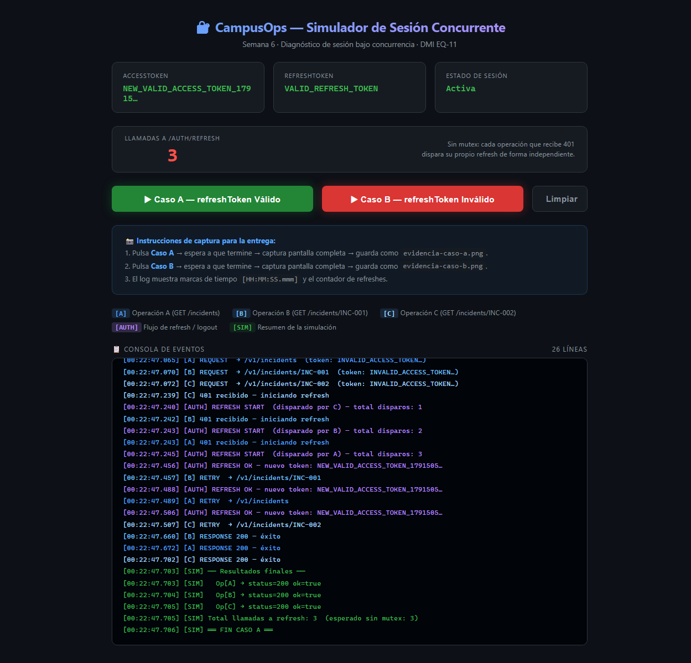
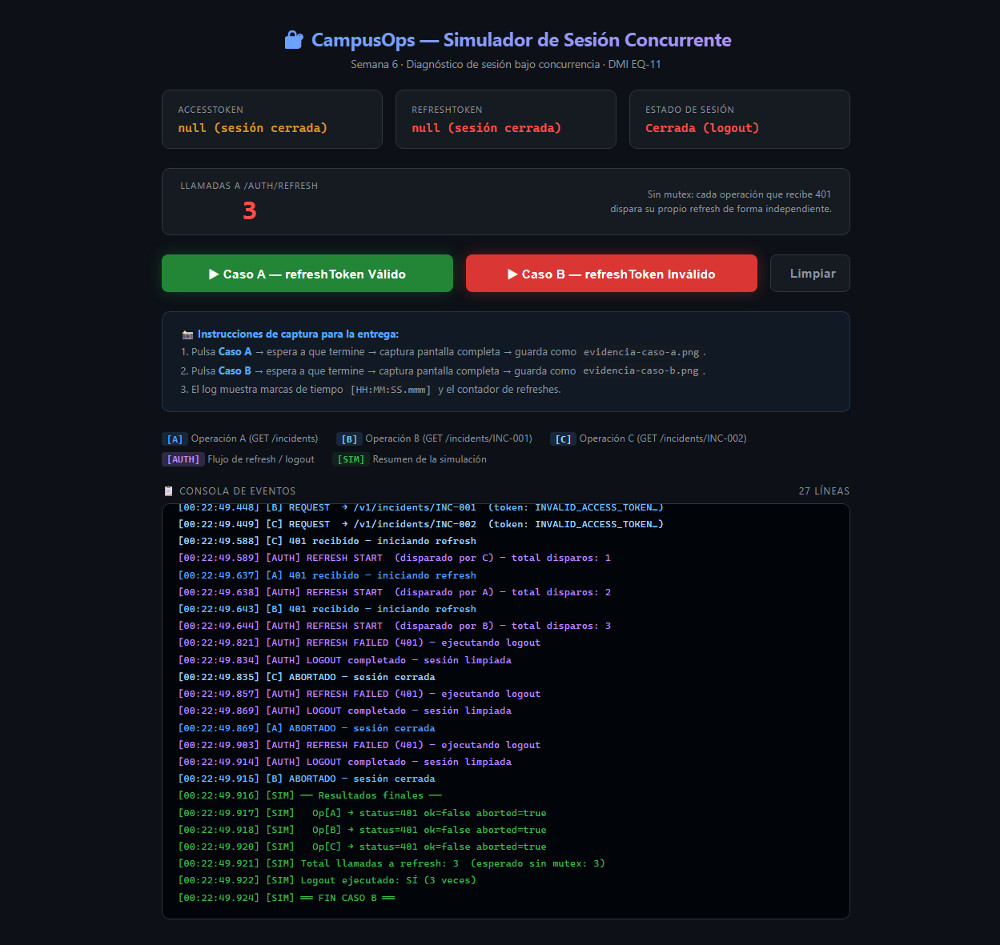

# Actividad Semana 6 — Diagnóstico de una sesión bajo concurrencia

**Materia:** Desarrollo Móvil Integral  
**Alumno:** Fernando Vazquez Valeriano
**Equipo:** EQ-11  
**Proyecto:** CampusOps_EQ11 (React Native + Expo)  
**Fecha:** 2026-10-08  
**Commit inspeccionado:** `57bd3a5` (tag `week-05-final`)

---

## 1. Inspección del proyecto real

### 1.1 Stack tecnológico

| Dimensión | Valor |
|-----------|-------|
| Framework | React Native 0.86.2 con Expo ~57 |
| Lenguaje | TypeScript ~6.0 |
| Almacenamiento de tokens | `expo-secure-store` ~57 (Keychain iOS / Keystore Android) |
| Cliente HTTP | `fetch` nativo envuelto en `CourseHttpClient` |
| Estado de autenticación | Semana 6 — **función pendiente de implementación** |

---

### 1.2 Tabla de inspección

| Elemento | Archivo(s) | ¿Existe? | Observaciones |
|----------|-----------|----------|---------------|
| **Cliente HTTP** | `src/infrastructure/http/CourseHttpClient.ts` | ✅ Implementado | Clase `CourseHttpClient.requestJson()` con timeout, AbortController y logging. Usa `fetch` nativo. |
| **accessToken** | `src/infrastructure/security/secureStorage.ts` | ✅ Implementado | Clave `campusops.sessionToken` en SecureStore. Funciones `saveSessionToken`, `getSessionToken`, `deleteSessionToken`. |
| **refreshToken** | `src/infrastructure/security/secureStorage.ts` | ✅ Implementado | Clave `campusops.refreshToken` en SecureStore. Funciones `saveRefreshToken`, `getRefreshToken`, `deleteRefreshToken`. |
| **Envío del token en requests** | `CourseHttpClient.ts` línea 68 | ⚠️ Hardcoded | El header `Authorization: 'Bearer course-valid-token'` está **fijo como literal**; no se lee de SecureStore. |
| **Interceptor de 401** | — | ❌ No existe | `requestJson()` retorna `{ ok: false, error: { kind: 'http', status: 401 } }` pero NO intercept ni reintenta. |
| **Manejo de 401 con refresh** | — | ❌ No existe | No hay ningún `if (status === 401) → refreshToken()` en el cliente ni en los repositorios. |
| **Mutex / lock de refresh** | — | ❌ No existe | Al no haber interceptor, tampoco hay mutex. `coordinateRefresh()` está declarada pero lanza `pending()`. |
| **Logout / limpieza de sesión** | `secureStorage.ts` línea 93 | ✅ Implementado | `clearSecureSession()` con `Promise.allSettled` borra sessionToken y refreshToken. |
| **`coordinateRefresh()`** | `src/course-evaluation/index.ts` línea 65 | ⚠️ Pendiente | Contrato definido en `contracts.ts`. Lanza `pending('coordinateRefresh')` → **tarea de Semana 6**. |

---

### 1.3 Flujo actual (sin interceptor)

```
Op A → requestJson() → fetch() → 401 → retorna { ok:false, error:{kind:'http',status:401} }
Op B → requestJson() → fetch() → 401 → retorna { ok:false, error:{kind:'http',status:401} }
Op C → requestJson() → fetch() → 401 → retorna { ok:false, error:{kind:'http',status:401} }

(Ninguna operación dispara refresh — el cliente devuelve el error y listo)
```

> La simulación **agrega** el interceptor-sin-mutex para diagnosticar qué pasaría
> si se implementa de forma ingenua, que es exactamente lo que pide la actividad.

---

## 2. Predicción antes de ejecutar

La simulación añade un interceptor **sin mutex**:

```
si response.status === 401:
    accessToken = await refreshToken()   // sin lock
    retry()
```

### Caso A (refreshToken válido)

| Pregunta | Predicción |
|----------|-----------|
| ¿Cuántas llamadas a `/auth/refresh`? | **3** — cada operación detecta el 401 de forma independiente |
| ¿Todas completan? | Sí, las 3 reintentan y obtienen 200 |
| ¿El token se sobreescribe? | Sí — race condition, la última escritura gana |
| ¿Hay riesgo en producción? | Sí — si el backend invalida tokens previos al emitir uno nuevo |

### Caso B (refreshToken inválido)

| Pregunta | Predicción |
|----------|-----------|
| ¿Cuántas llamadas a `/auth/refresh`? | **3** — cada operación intenta refresh |
| ¿Cuántos logouts? | **3** — cada operación ejecuta `clearSecureSession()` |
| ¿Las operaciones tienen éxito? | No — todas abortadas |
| ¿Hay efecto secundario? | Sí — 3 logouts sobre sesión ya vacía |

---

## 3. Resultados de la simulación

> **Simulador:** abrir `evidence/week-06/sim/index.html` en el navegador.

### 3.1 Caso A — accessToken inválido + refreshToken válido

```
[HH:MM:SS.mmm] [SIM]  ══ CASO A — accessToken inválido + refreshToken VÁLIDO ══
[HH:MM:SS.mmm] [SIM]  Lanzando 3 operaciones concurrentes con Promise.all…
[HH:MM:SS.mmm] [A]    REQUEST  → /v1/incidents  (token: INVALID_ACCESS_TOKEN…)
[HH:MM:SS.mmm] [B]    REQUEST  → /v1/incidents/INC-001  (token: INVALID_ACCESS_TOKEN…)
[HH:MM:SS.mmm] [C]    REQUEST  → /v1/incidents/INC-002  (token: INVALID_ACCESS_TOKEN…)
[HH:MM:SS.mmm] [A]    401 recibido — iniciando refresh
[HH:MM:SS.mmm] [B]    401 recibido — iniciando refresh
[HH:MM:SS.mmm] [C]    401 recibido — iniciando refresh
[HH:MM:SS.mmm] [AUTH] REFRESH START  (disparado por A) — total disparos: 1
[HH:MM:SS.mmm] [AUTH] REFRESH START  (disparado por B) — total disparos: 2
[HH:MM:SS.mmm] [AUTH] REFRESH START  (disparado por C) — total disparos: 3
[HH:MM:SS.mmm] [AUTH] REFRESH OK — nuevo token: NEW_VALID_ACCESS_TOKEN_…
[HH:MM:SS.mmm] [AUTH] REFRESH OK — nuevo token: NEW_VALID_ACCESS_TOKEN_…  (sobreescribe)
[HH:MM:SS.mmm] [AUTH] REFRESH OK — nuevo token: NEW_VALID_ACCESS_TOKEN_…  (sobreescribe)
[HH:MM:SS.mmm] [A]    RETRY  → /v1/incidents
[HH:MM:SS.mmm] [B]    RETRY  → /v1/incidents/INC-001
[HH:MM:SS.mmm] [C]    RETRY  → /v1/incidents/INC-002
[HH:MM:SS.mmm] [A]    RESPONSE 200 — éxito
[HH:MM:SS.mmm] [B]    RESPONSE 200 — éxito
[HH:MM:SS.mmm] [C]    RESPONSE 200 — éxito
[HH:MM:SS.mmm] [SIM]  Total llamadas a refresh: 3  (esperado sin mutex: 3)
[HH:MM:SS.mmm] [SIM]  ══ FIN CASO A ══
```

**📸 Evidencia Caso A:**



| Métrica | Observado | Óptimo con mutex |
|---------|-----------|-----------------|
| Llamadas a `/auth/refresh` | 3 | 1 |
| Operaciones exitosas | 3 / 3 | 3 / 3 |
| Sobreescrituras del token | 3 (race) | 0 |
| Tokens extras emitidos | 2 | 0 |

**Problema detectado:** 3 tokens distintos emitidos. Si el backend invalida los 2
anteriores al emitir el tercero, los retries de A y B usarían tokens ya expirados
→ fallo intermitente difícil de reproducir en producción.

---

### 3.2 Caso B — accessToken inválido + refreshToken inválido

```
[HH:MM:SS.mmm] [SIM]  ══ CASO B — accessToken inválido + refreshToken INVÁLIDO ══
[HH:MM:SS.mmm] [SIM]  Lanzando 3 operaciones concurrentes con Promise.all…
[HH:MM:SS.mmm] [A]    REQUEST  → /v1/incidents  (token: INVALID_ACCESS_TOKEN…)
[HH:MM:SS.mmm] [B]    REQUEST  → /v1/incidents/INC-001  (token: INVALID_ACCESS_TOKEN…)
[HH:MM:SS.mmm] [C]    REQUEST  → /v1/incidents/INC-002  (token: INVALID_ACCESS_TOKEN…)
[HH:MM:SS.mmm] [A]    401 recibido — iniciando refresh
[HH:MM:SS.mmm] [B]    401 recibido — iniciando refresh
[HH:MM:SS.mmm] [C]    401 recibido — iniciando refresh
[HH:MM:SS.mmm] [AUTH] REFRESH START  (disparado por A) — total disparos: 1
[HH:MM:SS.mmm] [AUTH] REFRESH START  (disparado por B) — total disparos: 2
[HH:MM:SS.mmm] [AUTH] REFRESH START  (disparado por C) — total disparos: 3
[HH:MM:SS.mmm] [AUTH] REFRESH FAILED (401) — ejecutando logout
[HH:MM:SS.mmm] [AUTH] LOGOUT completado — sesión limpiada
[HH:MM:SS.mmm] [AUTH] REFRESH FAILED (401) — ejecutando logout  (sesión ya limpia)
[HH:MM:SS.mmm] [AUTH] LOGOUT completado — sesión limpiada
[HH:MM:SS.mmm] [AUTH] REFRESH FAILED (401) — ejecutando logout  (sesión ya limpia)
[HH:MM:SS.mmm] [AUTH] LOGOUT completado — sesión limpiada
[HH:MM:SS.mmm] [A]    ABORTADO — sesión cerrada
[HH:MM:SS.mmm] [B]    ABORTADO — sesión cerrada
[HH:MM:SS.mmm] [C]    ABORTADO — sesión cerrada
[HH:MM:SS.mmm] [SIM]  Total llamadas a refresh: 3  (esperado sin mutex: 3)
[HH:MM:SS.mmm] [SIM]  Logout ejecutado: SÍ (3 veces)
[HH:MM:SS.mmm] [SIM]  ══ FIN CASO B ══
```

**📸 Evidencia Caso B:**



| Métrica | Observado | Óptimo con mutex |
|---------|-----------|-----------------|
| Llamadas a `/auth/refresh` | 3 | 1 |
| Llamadas a logout | 3 | 1 |
| Operaciones exitosas | 0 / 3 | 0 / 3 |
| Riesgo de logout múltiple en UI | Alto | Ninguno |

**Problema detectado:** `clearSecureSession()` se invoca 3 veces sobre sesión ya
vacía → 3 eventos de logout que podrían causar parpadeos o navegaciones duplicadas
hacia la pantalla de login.

---

## 4. Decisión técnica

### ¿Por qué es necesario un mutex?

Sin coordinación, N operaciones concurrentes con 401 producen N llamadas al refresh.
El patrón correcto:

```
Op A detecta 401:
  ¿hay refresh en vuelo?
    SI  → espera la misma promesa
    NO  → inicia refresh, guarda promesa compartida

Op B y C llegan → ven refresh en vuelo → esperan la misma promesa
Refresh termina → todas reintentan con el MISMO token nuevo
```

### Opciones evaluadas

| Solución | Pros | Contras |
|----------|------|---------|
| **Mutex con promesa compartida** | Simple, cero dependencias externas | Gestión manual del lock |
| **`coordinateRefresh()` del contrato** | Ya está en el contrato del proyecto | Pendiente de implementar |
| **Cola de reintentos** | Ordenada, permite prioridades | Más compleja |
| **Estado actual (sin cambios)** | Sin esfuerzo | N refreshes, N logouts, race conditions |

**Decisión:** implementar `coordinateRefresh()` con promesa compartida — el contrato
en `course-evaluation/index.ts` ya define los eventos `request401`, `refreshSucceeded`,
`refreshFailed` y `logout` necesarios.

---

## 5. Reflexión final

La concurrencia revela problemas invisibles en modo secuencial. El `CourseHttpClient`
actual es correcto en devolver el error 401 sin efectos secundarios de auth — es una
decisión de diseño sana (cliente sin lógica de negocio). El problema emergerá al
implementar el interceptor sin coordinación.

### Hallazgos clave

1. **No hay interceptor de 401** → la tarea de Semana 6 es construirlo correctamente
   con `coordinateRefresh()`.

2. **El token está hardcoded** en `CourseHttpClient.ts` línea 68
   (`'Bearer course-valid-token'`) → placeholder del curso, no un token real.
   La implementación final deberá leer de `getSessionToken()`.

3. **`clearSecureSession()` ya existe y es robusta** → `Promise.allSettled` garantiza
   que ambos tokens se borran aunque uno falle.

4. **Sin mutex**: Caso A → N tokens emitidos innecesariamente (race condition).
   Caso B → N logouts con efectos secundarios en la UI.

5. **La solución** es un mutex ligero: una promesa compartida que todas las operaciones
   concurrentes esperan, garantizando 1 refresh → 1 token → todos los retries exitosos.

---

## 6. Evidencias de entrega

| Archivo | Descripción |
|---------|-------------|
| `actividad-semana-6.md` | Este reporte |
| `evidencia-caso-a.png` | Captura del simulador — Caso A completo (3 refreshes exitosos) |
| `evidencia-caso-b.png` | Captura del simulador — Caso B completo (3 refreshes fallidos, 3 logouts) |
| `evidence/week-06/sim/index.html` | Simulador standalone (no toca el proyecto) |
| `evidence/week-06/sim/auth-sim.js` | Lógica de simulación standalone |

---

